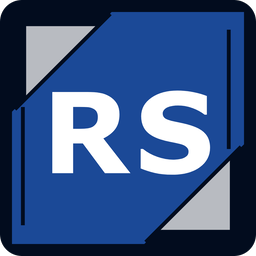

# RS DeskView — installateurs

**RS DeskView**, par Reference Services : voir, entendre et contrôler un PC à distance (réseau local ou Internet), avec presse-papiers, transfert de fichiers et accès sans surveillance par mot de passe.

Ce dépôt ne contient que les **installateurs** et les fichiers dont l'appli a besoin pour se **mettre à jour toute seule**. Le code source est privé.

**Télécharger la dernière version :** [page Releases](https://github.com/refserv/bureau-a-distance-releases/releases/latest)

| Système | Fichier |
|---|---|
| Windows | `RS-DeskView-<version>-Windows-Setup.exe` |
| macOS (Apple Silicon) | `RS-DeskView-<version>-macOS-arm64.dmg` |
| macOS (Intel) | `RS-DeskView-<version>-macOS-x64.dmg` |
| Linux | `RS-DeskView-<version>-Linux-x86_64.AppImage` |

Les installateurs ne sont pas encore signés : sous Windows, clique sur **Informations complémentaires → Exécuter quand même** ; sur Mac, fais **clic droit → Ouvrir** la première fois.

Les fichiers `latest*.yml` servent aux mises à jour automatiques (Windows et Linux) : ne les supprime pas.

*Les versions jusqu'à 1.2.1 s'appelaient « Bureau a distance ».*
